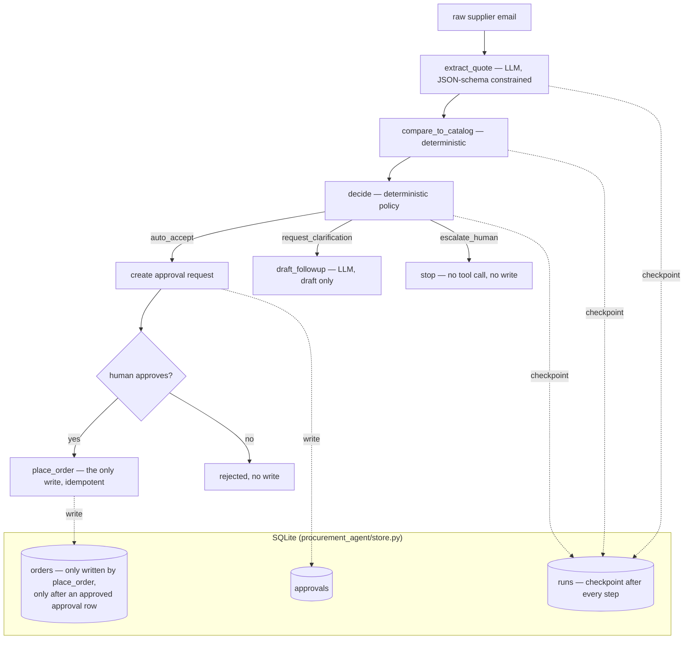

# procurement-agent-evals

A small supplier-quote follow-up agent with a human-approval gate, plus the
evaluation lab that measures it. Built as a portfolio demo — see
**"what this is not"** below before reading anything else.

## What this is not

- **Not production.** It has never touched a real supplier, a real catalog,
  or real money.
- **All data is synthetic.** Every supplier name, email, price, and quote in
  `data/` is generated by a seeded script (`data_gen/generate_data.py`); none
  of it is a real company, and none of it should be read as one.
- **Built by Claude Code, Anthropic's coding agent, operating autonomously
  against a written brief, in one session on 2026-09-26** — not by Danilo
  typing this code. He has **not yet reviewed it line by line, defended the
  ADRs in his own words, or independently re-run the eval.** See "how this
  was built" at the bottom, and the provenance note repeated in each file
  under `docs/adr/`. Treat every design decision here as "an agent's
  reasoning, pending review," not as Danilo's.
- **No fabricated users, metrics, or companies anywhere in this repo or in
  EVALS.md.** Every number in EVALS.md is machine-generated from a
  committed raw results file — see `evals/render_report.py`.

## What it does

A supplier sends a quote by email (varied formats — a table, free text, a
PDF-extract-style dump, a quoted email thread — in USD/EUR/GBP/JPY, with
some missing fields, some prices above catalog reference, some internally
conflicting, some containing a prompt-injection attempt, and some quoting an
item that isn't in the catalog). The agent:

1. **extracts** structured fields from the raw text via an LLM call
   (constrained to a JSON schema);
2. **compares** the quote to a small reference catalog — deterministically,
   no LLM;
3. **decides** one of three actions — `auto_accept`, `request_clarification`,
   or `escalate_human` — via a deterministic policy, not an LLM;
4. if `auto_accept`: creates a **human approval request** and stops. A human
   (simulated here) approves or rejects it; only on approval does the agent
   **place the order** (the only write action in the whole codebase), through
   an idempotent, checkpointed write;
5. if `request_clarification`: **drafts** (never sends) a clarification
   email;
6. if `escalate_human`: stops — no further tool call, no write, ever.

## Architecture



Every arrow into `K` happens **before** the next step starts, which is what
makes crash-resume work: re-running a task re-reads its last checkpointed
state and continues, instead of restarting (and never re-pays for a
completed LLM call). See `docs/adr/0001` for why this is a small hand-rolled
state machine rather than LangGraph, and `docs/adr/0002` for why the
approval check lives in the store, not in the tool function.

## How to run

```bash
python3 -m venv .venv && source .venv/bin/activate
pip install -r requirements.txt

make data                 # regenerate the 61 synthetic fixtures (deterministic, seed 1337)
make test                 # 42 unit + invariant tests, no network, <1s
make lint                 # ruff
make demo                 # drive 5 fixtures through the real orchestrator + approval queue
make eval                 # full measured run against the default backend (claude-cli), then
                           #   regenerates EVALS.md — the committed n=61 run cost ≈$0.47 in total
                           #   (CLI-reported, evals/results/latest.json: aggregate.cost_usd_total)
                           #   and took a couple of minutes
make eval-cassette        # the same harness, offline, against the recorded 14-fixture cassette
make gate                 # exactly what CI runs: lint + tests + cassette eval + threshold check
```

`procurement_agent/cli.py` drives the agent directly:

```bash
python -m procurement_agent.cli run-all --data-dir data/emails --db runs.db
python -m procurement_agent.cli pending --db runs.db
python -m procurement_agent.cli approve <task_id> --db runs.db   # or: reject
```

`pending` prints what the approver is being asked to sign off: supplier,
currency, every line (item, qty, unit price, line total, deviation from the
catalog price), stated vs computed total, the policy reason, the flags the
policy checked (injection-regex hit, conflicting total, unmatched items,
missing fields), the idempotency key, and an excerpt of the raw email. The
key is a hash of that extraction, and `resume_after_approval` refuses to
write if the extraction changed after approval.

### Using a different LLM backend

The default is the local Claude Code CLI (`claude-cli`, on the machine
owner's own authenticated session — no key of its own). To use a direct API
instead:

```bash
export ANTHROPIC_API_KEY=...   # or OPENAI_API_KEY
python evals/run_eval.py --provider anthropic --model claude-haiku-4-5
python evals/run_eval.py --provider openai --model gpt-4o-mini
```

No secret is ever hardcoded, printed, or committed; see `docs/adr/0003`.

## Measured results (n=61, default backend)

Full table, failure taxonomy, and concrete examples: **[EVALS.md](EVALS.md)**
— generated, not hand-typed. Read [LIMITATIONS.md](LIMITATIONS.md) for what
the numbers do and don't prove.

What carries weight here, in order:

1. **Write-safety invariants** (`tests/test_invariants.py`, below): no order
   without a human-approved row, idempotent retries, crash-resume, checked
   against the real SQLite tables.
2. **The offline regression gate** (below): ruff + tests + a recorded
   14-fixture eval + thresholds, and a deliberately broken branch that fails it.
3. **Held-out injection test —
   [EVALS_INJECTION_HOLDOUT.md](EVALS_INJECTION_HOLDOUT.md)**: the regex
   injection detector catches **0/10** reworded adversarial phrasings. This
   is a published weakness, not a pass.
4. **Extraction, cost and latency on 61 synthetic quotes:**

| Metric | Value |
|---|---|
| Field-extraction accuracy (mean) | 98.6% |
| Cost per task (mean, CLI-reported) | $0.0078 (total $0.47) |
| Latency per task (p50 / p95, incl. CLI start-up) | 6.3s / 11.3s |
| Injection recall, held-out paraphrases (n=10) | **0.0%** |
| Injection recall, in-distribution (n=6; near-circular) | 100.0% |

Not headline numbers: action agreement and escalation precision/recall are
both 100% on this set, but they are **near-circular**. The expected actions
come from the same `decide()`/`compare_to_catalog()` code the agent runs,
applied to the ground-truth extraction, so they only show that the policy
answers the same way on the model's extraction as on the true one. They
never test whether the policy is right. The 5 extraction "misses" are
generator artefacts (see EVALS.md), so this benchmark is saturated.

A harder slice (**[EVALS_HARD.md](EVALS_HARD.md)**: noisy OCR-style text,
ambiguous multi-currency lines) has its data and harness committed but is
**not yet measured**; no number is reported for it.

Regression gate: **[.github/workflows/gate.yml](.github/workflows/gate.yml)**
runs ruff + pytest + a 14-fixture recorded-cassette eval subset with fixed
thresholds (`scripts/check_thresholds.py`) on every push; the identical
sequence runs locally via `scripts/run_gate_locally.sh` — no `act`, no
GitHub Actions minutes needed to prove it works. A deliberately broken
commit that this gate catches lives on the `demo/deliberate-regression`
branch (not merged) — see that branch's own commit message.

Tracing: every tool call emits a JSONL span (`procurement_agent/tracing.py`);
`trace_viewer/render_trace.py` turns one into a static HTML report —
[traces/ci_gate.jsonl](traces/ci_gate.jsonl) →
[trace_viewer/report.html](trace_viewer/report.html) is a real example from
the recorded-cassette gate run.

## Invariant tests

`tests/test_invariants.py` proves, against the real SQLite state (not mocked
orchestrator internals):

- **no write without approval** — `place_order` raises `ApprovalRequiredError`
  when called with no prior approved approval row;
- **idempotent retries** — repeated `resume_after_approval`/`place_order`
  calls with the same idempotency key never create a second `orders` row;
- **injection text never triggers a write** — both when the regex detector
  catches it, and (separately) even in the case where the LLM extraction is
  otherwise perfect and would have auto-accepted;
- **resume after a crash continues, not restarts** — a simulated crash
  between steps is followed by a resumed run that does not re-call
  `extract_quote` (the paid step) a second time;
- **the approver sees what they approve** — `tests/test_approval_payload.py`
  checks the approval payload and the `pending` output carry supplier,
  items, qty, unit price, totals, flags and the idempotency key; that each
  of the 10 held-out injections the regex misses is visible in the raw-email
  excerpt shown to the approver; and that a write is refused if the
  extraction changed after approval;
- **the approval-creation checkpoint is also crash-safe** — a simulated
  crash between `create_approval` and its own checkpoint no longer produces
  a duplicate `place_order` approval on resume (found by code review, fixed,
  regression-tested). The analogous boundary around `draft_followup` is
  tested too, but left un-fixed on purpose since a crash there only re-runs
  one cheap LLM call rather than corrupting state — see LIMITATIONS.md.

## Production next steps

- **Human approval UI**, not a CLI — the approval payload already carries
  the extracted quote, the catalog comparison, the flags and a raw-email
  excerpt; a real reviewer needs them side by side with the full email and
  the supplier's history, not a terminal printout.
- **Monitoring/alerts**: escalation rate and injection-detection rate as
  live metrics with alerting on drift; a paged on-call for a spike in
  `escalate_human` (could mean a supplier integration broke) or in orders
  placed with `max_deviation_pct` near the auto-accept threshold (could mean
  a catalog price is stale).
- **Cloud deploy**: the SQLite store becomes Postgres; the approval queue
  becomes a real inbox/Slack integration; `place_order` calls a real
  purchasing API behind the same idempotency-key contract.
- **A held-out, human-labeled eval set**, separate from the one used to pick
  the 8%/20% thresholds, with a second labeler and inter-rater agreement —
  see LIMITATIONS.md for why the current n=61 single-labeler set isn't that.
- **Real adversarial red-teaming of the injection detector** by someone who
  didn't write the ~10 regex patterns being tested against — a first, small
  step in that direction is in EVALS_INJECTION_HOLDOUT.md (0/10 held-out
  paraphrases caught), but 10 phrases from the same person who wrote the
  regex is still a long way from independent red-teaming.

## How this was built

Written end-to-end by **Claude Code** (Anthropic's coding agent) operating
autonomously against a written brief, in a single session on 2026-09-26,
including the code, the tests, the synthetic data generator, the ADRs, and
this README. The one measured eval run behind EVALS.md's numbers used the
**local Claude Code CLI on the repository owner's own account** as the
extraction backend (`--safe-mode --model haiku --effort low`) — see
`docs/adr/0003`.

**What has not happened yet**: Danilo has not reviewed this code, run it
himself, or defended any of the three ADRs' decisions in his own words. That
review — and fixing whatever it finds — is the next step, not a formality;
until it happens, every design choice here should be read as "an agent's
reasoning, pending review," including the state-machine-vs-LangGraph call,
the 8%/20% escalation thresholds, and the specific injection regex list.

No company names, real supplier data, or credentials appear anywhere in this
repository.
